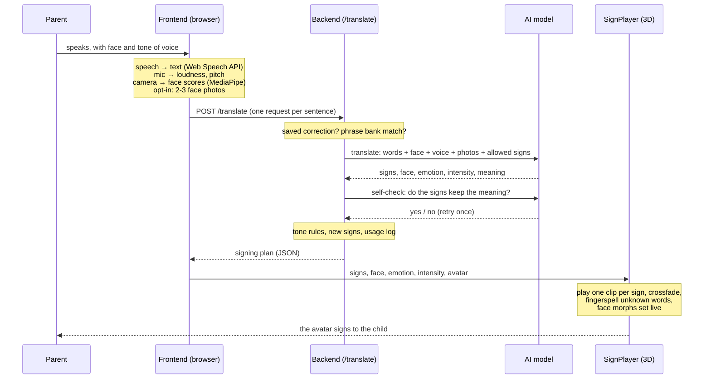

# Wiring guide: from the parent's voice to the signing avatar

For whoever connects the backend, the frontend and the 3D signer. Read this first, then `CONTRACT.md` for exact field rules.

> **The animations don't exist yet.** The letter clips (A–Z) and the per-word clips are being animated *after* the wiring is done. Wire against missing clips, as described in [section 5a](#5a-wiring-before-the-animations-exist): the player must work with zero clips and pick new ones up automatically when a new GLB lands.

> **Already on `main`:** the fields below (`loudness`, `pitch`, `face_frames`, `intensity`, `tone_reason`) and the `/dev` test page came in with PR #8.

---

## 1. The end-to-end flow in one paragraph

The parent speaks. **The browser** does all the capturing:
- speech becomes text;
- the mic gives loudness and pitch numbers;
- the camera gives face-expression scores;
- optionally, 2 to 3 small face photos.

When the sentence ends, the frontend sends **one request** to the backend. The **backend** turns it into a **signing plan**:
- which signs, in ASL order;
- the grammar face;
- the emotion and how strong it is;
- what it understood the parent to mean.

It uses the AI, the list of signs the avatar can do, and a few rules. The **3D signer** plays the plan by **stitching pre-made animation clips**, one per sign, and setting the face live. Nothing is animated on the fly.



---

## 2. Things that are easy to get wrong

| If you think... | Actually... |
|---|---|
| The browser sends audio or video to the backend | **Never.** Only text and numbers leave the browser. Speech is turned into text in the browser. Tone becomes two numbers (`loudness`, `pitch`). The face becomes 7 scores. The one exception is opt-in face photos (2 to 3 small JPEGs per sentence), and only when the parent turns that on. |
| The backend works out the emotion from a dataset | No dataset is involved in emotion. **The AI decides the emotion** in the same call that writes the translation, by weighing the words, the face (scores and photos) and the voice. A few fixed rules sit around it (section 4). |
| ASL-LEX is used to translate | **No.** ASL-LEX is a research dictionary. It decides *which signs to animate next* and *which signs to suggest to parents* (`/progress`). The AI never sees it. |
| The AI can use any ASL sign | The AI may only use glosses in **`shared/vocab.json`**, the signs that have an animation clip, currently 26. Any other word comes back as `known: false` and gets **fingerspelled**. |
| The avatar's animation is generated live | **Body animation is pre-made clips**, one per gloss, played in order with short blends. Only the **face** is computed live (morph-target weights) from `face`, `emotion` and `intensity`. |
| `face` and `emotion` are the same thing | `face` is **grammar**: the eyebrows for statements and questions. `emotion` is **feeling**: the rest of the face plus how big and sharp the signing is. An angry question needs both. |
| The answer comes back instantly | A sentence takes **about 10 to 18 seconds**: two AI calls (translate, then self-check), and longer with photos. Show a loading state, and block double-sending. |
| One request per word, or streaming | **One request per finished sentence**, sent after speech recognition gives its final result. |

---

## 3. What each part sends and receives

### 3a. Frontend → backend: `POST http://localhost:8000/translate`

```json
{
  "text": "if you hit your sister again you're going to time out",
  "face_emotions": {"neutral": 0.0, "happy": 0.03, "sad": 0.01, "angry": 0.67, "fearful": 0.03, "disgusted": 0.25, "surprised": 0.01},
  "loudness": 0.8,
  "pitch": 0.3,
  "speaker": "mom",
  "face_frames": ["<base64 jpeg>", "<base64 jpeg>"],
  "face_neutral": "<base64 jpeg>"
}
```

Only `text` is required; send the rest when you have it.

| Field | Comes from | Notes |
|---|---|---|
| `text` | Web Speech API final transcript (`frontend/src/lib/speech.js`) or the typed box | 1 to 300 characters |
| `face_emotions` | MediaPipe Face Landmarker → 7 scores | Use the strongest moments of the sentence, not the average. Leave it out if no face was seen. |
| `loudness`, `pitch` | Web Audio level and pitchy, compared with *this parent's normal* | -1 to 1. Leave out what you couldn't measure. |
| `speaker` | the "Who's talking?" picker | a member id from `/family` |
| `face_frames`, `face_neutral` | canvas snapshots | **Only when the parent has switched "let AI see my face" on.** Off by default. |
| `emotion` | the parent picked it by hand | Overrides everything. Only send it when the parent chose it. |

**Copy, don't rewrite:** `backend/dev.html` already does all of this capture, and it works.
- `cuesOf` and `emotionsOf`: face scores from MediaPipe.
- `averageSamples`: the strong-moments summary for a sentence.
- `startLevels` and `stopLevels`: loudness and pitch.
- `considerPeak` and `snap`: picking and taking the photos.
- the neutral-face calibration button.

Start the backend and open http://localhost:8000/dev to see it run.

### 3b. Backend → frontend: the signing plan

```json
{
  "signs": [{"gloss": "IF", "known": false}, {"gloss": "YOU", "known": true}, {"gloss": "TIME-OUT", "known": false}],
  "face": "statement",
  "emotion": "angry",
  "intensity": 0.8,
  "tone_reason": "a warning; brows lowered vs neutral photo; voice raised",
  "meaning": "Warning: hitting again means a time-out",
  "source": "model",
  "unsure": false,
  "new_signs": ["YOU"]
}
```

| Field | Who uses it | How |
|---|---|---|
| `signs` | 3D signer | Play in this order. `known: true` → clip with that exact name. `known: false` → fingerspell the letters. |
| `face` | 3D signer | `statement` / `yes-no-question` (brows up) / `wh-question` (brows down). On questions, the grammar brows win over the emotion's brows. |
| `emotion` + `intensity` | 3D signer | Expression from the table in `handoff/3d-signer.md`, scaled by `intensity` (0.5 = table values). Also scales sign speed and size. |
| `meaning` | Frontend | Show it ("I understood: …") so the parent can correct it via `POST /corrections`. |
| `source`, `unsure` | Frontend | Show a "check this" badge when `unsure` is true or `source` is `fallback`. |
| `new_signs` | Frontend | Highlight them: they grow the child's vocabulary. |
| `tone_reason` | Testing | Debug view only; parents don't need it. |

### 3c. Frontend → 3D signer

```jsx
<SignPlayer signs={plan.signs} face={plan.face} emotion={plan.emotion}
            intensity={plan.intensity} avatar={member.avatar} />
```

The `SignPlayer` on `main` is still a text placeholder. It needs to become the three.js player described in section 5.

---

## 4. What the backend does, step by step

1. **Validate** everything: lengths, ranges, the 7 face keys, real JPEGs. Invalid input gives an HTTP 422 with a reason.
2. **Saved correction:** if the parent corrected *this exact sentence* before, their meaning and emotion are used as input.
3. **Phrase bank** (`shared/phrases.json`): if this exact sentence was checked by a fluent signer, use that translation. No AI, instant. It's empty today and fills up as a signer reviews translations.
4. **AI translate, one call.** The AI gets:
   - the sentence;
   - the allowed glosses from `vocab.json`;
   - the face scores, and photos if sent;
   - loudness and pitch;
   - similar checked examples, and recent corrections;
   - the tone rules.

   It returns the signs in ASL order, the face, emotion, intensity, tone reason and meaning. Glosses not in the list are rejected, and the AI gets one retry.
5. **AI self-check, a second call.** A fresh request turns the signs back into English and judges whether the meaning survived. If not, one retry; if it still fails, the result is marked `unsure: true`.
6. **Tone rules (no AI):**
   - an emotion the parent picked always wins;
   - a neutral answer never overrides a strong face (one emotion at 0.6 or more);
   - a neutral face never overrides anything.
7. **Fallback:** if the AI is unreachable or the 45-second budget runs out, the backend returns a rough word-for-word version marked `source: "fallback"`, `unsure: true`. The app keeps working with no AI key at all.
8. **Bookkeeping:** `new_signs` is computed and the known signs are logged for `/progress`. Photos are never stored or logged.

**Data the backend reads:**

| File | Role |
|---|---|
| `shared/vocab.json` | The signs the avatar can perform, and the only glosses the AI may use. **Must match the clip names in the GLB.** |
| `shared/phrases.json` | Whole sentences checked by a fluent signer, used before the AI. |
| `shared/asl_lex.json` | Research dictionary for `/progress` and "what to animate next". Not used to translate. |
| `backend/data/*.json` | Local, git-ignored: corrections, family profile, usage log. |

**Config (`.env` at the repo root, never committed):**
- `LLM_PROVIDER=openai`
- `LLM_MODEL=gpt-6.1-sol` (must accept images if photos are used)
- `OPENAI_API_KEY=…`

We plan to switch to Gemini; that's one small addition in `backend/llm.py`.

---

## 5. What the 3D signer must provide

**Clips:**
- One animation clip per gloss, named **exactly** like the gloss (`YOU`, `WANT`, `MORE`, `MILK`…).
- Each clip starts and ends near a neutral rest pose, so clips chain smoothly.
- 26 letter clips for fingerspelling, named `FS_A` … `FS_Z`. The `FS_` prefix keeps letters from clashing with a word clip.

**Player (three.js):**
- One `AnimationMixer`: for each sign, play its clip and crossfade (about 0.15 s) into the next.
- Clip speed scales with `intensity`.
- `known: false` → play `FS_<letter>` for each letter; skip anything that isn't a letter.

**Face:**
- Set morph-target weights every frame from `face`, `emotion` and `intensity` (table in `handoff/3d-signer.md`).
- The morph names on both models are ARKit-style: `browInnerUp`, `browDownLeft`, `jawOpen`, `mouthSmileLeft`…

**Avatars:**
- `avatar` prop → load `frontend/public/models/<avatar>.glb`.
- All avatars share the same 43 bone names, but a clip stores rotations relative to its own rig's rest pose, so a clip only plays correctly on an avatar it was made or retargeted for.

**Current state:** `signer_glasses.glb` (the default avatar) has a clip for **every gloss in `vocab.json`** plus `FS_A` … `FS_Z`, so every sentence the backend can return plays fully animated, and unknown words are fingerspelled. `signer_tshirt.glb` still has only its whole-sentence clip (`YOU_WANT_MORE_MILK`). The clips are posed for the glasses rig and haven't been retargeted to it. Its rest pose differs (arms down, not a T-pose), so they won't play correctly on it as they are.

### 5a. Wiring before the animations exist

The plan is to animate **all 26 letters plus common words** chosen from the dataset: `shared/next_signs.md` lists the ASL children's-vocabulary signs, earliest-learned first. None of those clips exist yet, so the player has to be built to cope.

- **Discover clips at load, never hard-code them.** After loading the GLB, build a lookup from `gltf.animations` by clip name. Whatever names are in the file are the signs the avatar can play. New clips then need no code change: export the new GLB, replace the file, reload.
- **A missing word clip shows the word.** If a gloss has no clip, show the gloss as a text card for about the length of a sign (the current placeholder `SignPlayer` already does this), then move on. Don't throw and don't stall the sequence.
- **Missing letter clips show the letters.** For `known: false`, play `FS_<letter>` clips where they exist; otherwise show the letters one at a time.
- **The face works with no clips at all.** Brows, emotion and intensity are morph targets, and both models on `main` already have them. So the avatar can show the question face and the emotion on top of the text cards before any body clip exists.
- **Test with what's there:** `shared/sign_animation_map.json` lists test phrases whose signs all have clips ("Do you want more milk?", "I love you.", "What do you want to eat?", …).
- **The backend doesn't change.** It keeps returning glosses from `vocab.json` (26 today, all animated).

**When the animator delivers clips:**
1. Name each word clip **exactly** like its gloss in `vocab.json`: uppercase, hyphens kept, e.g. `ALL-DONE`, `MILK`. Name letters `FS_A` … `FS_Z`.
2. Each clip starts and ends near the same neutral rest pose.
3. Export one GLB per avatar with all the clips, using the same skeleton for every avatar.
4. For a *new* word, also add it to `vocab.json` with its English words and ASL-LEX entry name from `next_signs.md`, e.g. `{"gloss": "BALL", "english": ["ball"], "asl_lex": "ball"}`. Then restart the backend so the AI can start using it.

**The sync rule:** add a gloss to `vocab.json` only after its clip exists in the GLB. Otherwise the AI can pick a sign the avatar can't perform. `shared/next_signs.md` ranks which signs to animate next.

---

## 6. Running it locally

```
# backend (repo root)
pip install -r backend/requirements.txt
uvicorn backend.main:app --reload --port 8000    # test it at http://localhost:8000/dev

# frontend
cd frontend && npm install && npm run dev         # http://localhost:5173 (CORS allows only this origin)
```

- Use **Chrome or Edge**: speech recognition doesn't work in Firefox.
- The camera and mic need `localhost` or https.
- MediaPipe and pitchy load from a CDN, so the machine needs internet.

---

## 7. Wiring checklist

**Before you start**
- [ ] Latest `main` pulled; `.env` set; `/dev` shows a model translation (`source: model`).

**Frontend**
- [ ] `api.js` `translate()` sends `text` plus `face_emotions`, `loudness`, `pitch`, `speaker`, and photos only when the switch is on.
- [ ] Capture code copied from `backend/dev.html`, including the "Record my neutral face" step.
- [ ] Loading state during the request; the Speak button is blocked while waiting.
- [ ] Meaning line, an unsure/fallback badge, and a Fix button (`POST /corrections`).
- [ ] `SignPlayer` receives `signs`, `face`, `emotion`, `intensity` and `avatar`.

**3D signer**
- [ ] Player discovers clips from the GLB at load; a missing clip shows a text card instead of failing.
- [ ] (Later, as animations land) per-sign clips named like the glosses, plus `FS_A`…`FS_Z`.
- [ ] three.js player: clips in order with crossfades; fingerspelling; morphs from face, emotion and intensity.
- [ ] Every gloss in `vocab.json` has a clip.

**End to end**
- [ ] Now: "Do you want more milk?" → `YOU WANT MORE MILK` as text cards, with the avatar's brows up.
- [ ] Later, once the clips exist: the same sentence plays as four blended clips, with no code change.
- [ ] A frowned warning → `emotion: angry`, a firm face, sharper signing.
- [ ] Backend stopped → a friendly error in the frontend, no crash.
